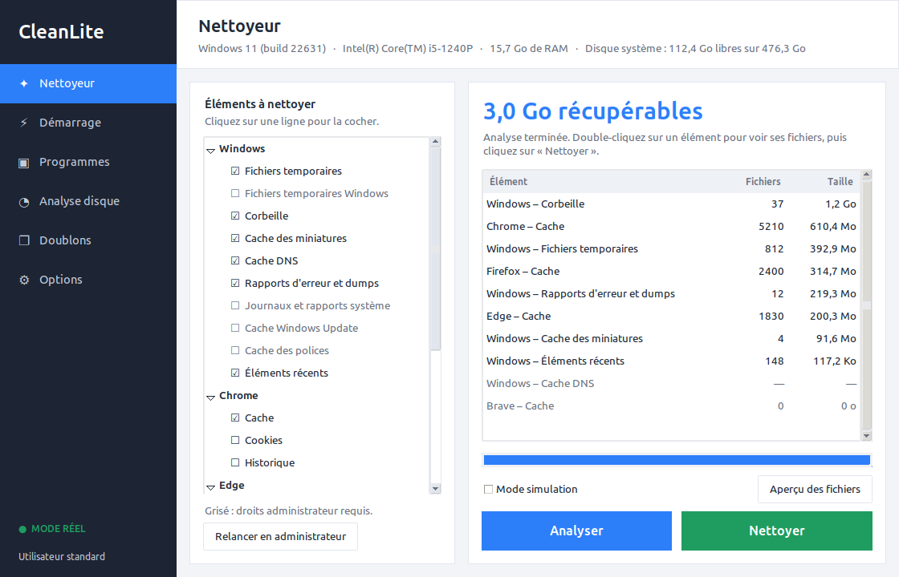

# CleanLite

Utilitaire de nettoyage **prudent** pour Windows 10/11, inspiré de CCleaner. Python + tkinter, aucune dépendance externe, aucune télémétrie, aucun accès réseau.



*Page Nettoyeur après une analyse (capture de développement, données d'exemple).*

## Installation (Windows)

```powershell
git clone <url-du-depot> CleanLite
cd CleanLite
powershell -ExecutionPolicy Bypass -File install.ps1
```

Un raccourci **CleanLite** est créé sur le Bureau et dans le menu Démarrer. Si Python 3.11+ manque, le script indique la commande `winget` à lancer.
Désinstallation : `powershell -ExecutionPolicy Bypass -File uninstall.ps1`. Exécutable autonome (optionnel) : `build_exe.ps1` produit `dist\CleanLite.exe`.

## Fonctionnalités

| Page | Rôle |
|---|---|
| Nettoyeur | Temporaires, corbeille, caches Chrome/Edge/Brave/Firefox (cookies et historique décochés par défaut), miniatures, DNS, rapports d'erreur, journaux, cache Windows Update, cache des polices, éléments récents. « Analyser » montre la taille récupérable, « Nettoyer » le total libéré. |
| Démarrage | Clés Run HKCU/HKLM, dossier Démarrage, tâches planifiées : activer/désactiver, jamais supprimer. |
| Programmes | Liste du registre (lecture seule), lance le désinstalleur officiel. |
| Analyse disque | Plus gros dossiers et fichiers d'un lecteur, en arrière-plan. |
| Doublons | Taille puis empreinte blake2b ; envoi à la corbeille uniquement, dossiers système exclus. |
| Options | Mode simulation, nettoyage hebdomadaire planifié, journal, relance en administrateur. |

## Sécurité

- Liste blanche stricte : chaque suppression vérifie que le chemin **résolu** (liens, jonctions, `..`) est sous un dossier autorisé.
- **Mode simulation activé au premier lancement** ; confirmation avant tout nettoyage réel.
- Fichiers verrouillés ignorés et comptés ; navigateurs ouverts signalés.
- Tourne en utilisateur standard ; les catégories admin sont grisées, avec un bouton « Relancer en administrateur ».
- Journal : `%LOCALAPPDATA%\CleanLite\log.txt`.
- Volontairement absents : nettoyeur de registre, pilotes, services, effacement de l'espace libre, « boost ».

## Développement

```bash
python3 tests/test_safety.py      # tourne aussi sous Linux
python3 tools/make_icon.py        # régénère assets/icon.ico (Pillow requis)
```
